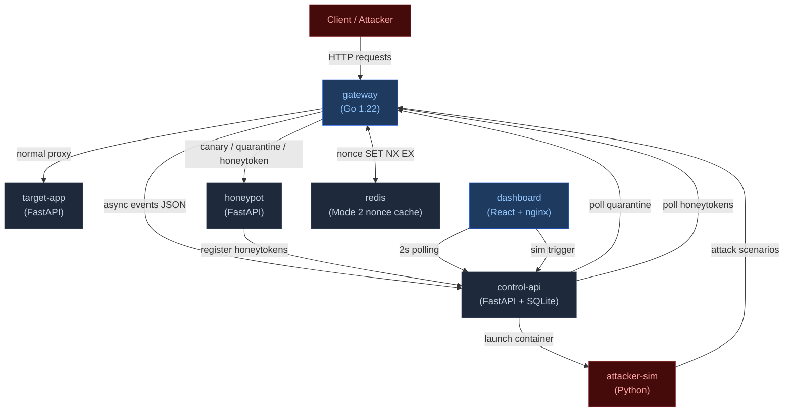
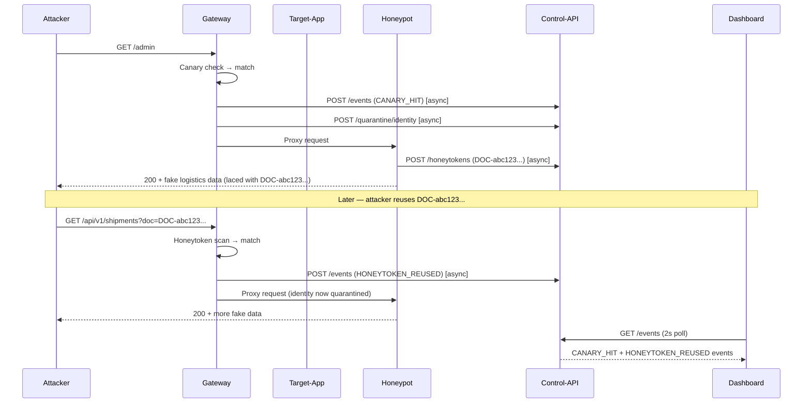

# TCAD Mesh — Architecture

## Overview

TCAD Mesh is a transparent active-defense gateway (reverse proxy) deployed in
front of an internal API service. It operates in two modes:

- **Mode 1 (Drop-In):** Zero changes to backend or client. Detects enumeration,
  canary path hits, and honeytoken reuse. Routes attackers to a honeypot.
- **Mode 2 (Hardened):** Adds time-based moving-target routing (HMAC-derived
  paths), anti-replay nonce validation, and tripwire classification.

---

## System Architecture



**Exposure:** Only `gateway:8080` and `dashboard:3000` are bound to the host.
All other services communicate on the internal Docker `mesh` network.

---

## Mode 1 Detection Pipeline

Every incoming request passes through these steps in order.
`time.Now()` is called **once** at entry — never multiple times in a single
routing decision (AGENTS.md §5 anti-pattern guard).

```mermaid
flowchart TD
    A["Incoming Request"] --> B["1. Identity Extraction\nX-Device-ID header → IP fallback"]
    B --> C{Quarantined?}
    C -->|Yes| HP["→ Honeypot\n(transparent)"]
    C -->|No| D{Honeytoken in URI?}
    D -->|Yes| QHT["Quarantine + HONEYTOKEN_REUSED\n→ Honeypot"]
    D -->|No| E{Canary path?}
    E -->|Yes| QC["Quarantine + CANARY_HIT\n→ Honeypot"]
    E -->|No| F["Proxy → target-app\n(buffer response)"]
    F --> G{Upstream 404?}
    G -->|No| NORM["8. Header Normalisation\n→ Flush to client"]
    G -->|Yes| H["Increment 404 counter\n(sliding window)"]
    H --> I{Counter > threshold?}
    I -->|No| NORM
    I -->|Yes| J["Emit ENUM_DETECTED"]
    J --> K{Tarpit semaphore\navailable?}
    K -->|No| RETURN429["Return 429\n+ TARPIT_SATURATED"]
    K -->|Yes| SLEEP["Delay TARPIT_DELAY_MS\n+ TARPIT_ACTIVE"]
    SLEEP --> NORM

    style HP fill:#1e293b
    style QHT fill:#450a0a
    style QC fill:#450a0a
    style RETURN429 fill:#431407
```



---

## Mode 2 Pipeline (prepended to Mode 1)

When `MODE2_ENABLED=true`, an additional step runs **before** the Mode 1 pipeline:

```mermaid
flowchart TD
    A["Incoming Request\n/m/<interval>-<mac16>/<path>"] --> B["Parse route segment"]
    B --> C{Valid format?}
    C -->|No| FALLTHROUGH["Fall through → Mode 1"]
    C -->|Yes| D["Compute cur_interval = floor(now/INTERVAL_SEC)\nnow calculated ONCE"]
    D --> E["ValidateMAC16 — constant-time compare\nHMAC-SHA256(secret, 'route:'+interval)[:16]"]
    E --> F{MAC correct?}
    F -->|No| R404["Return 404"]
    F -->|Yes| G{interval ∈ cur±GRACE?}
    G -->|No| TW["TRIPWIRE_HIT\nQuarantine → Honeypot"]
    G -->|Yes| H["Verify X-Signature\nconstant-time\nHMAC(secret, method|path|sha256(body)|ts|nonce)"]
    H --> I{Signature valid?}
    I -->|No| R401A["Return 401"]
    I -->|Yes| J["Check nonce in Redis\nSET NX EX 180"]
    J --> K{Nonce fresh?}
    K -->|No| REPLAY["REPLAY_REJECTED\nReturn 401"]
    K -->|Yes| PROXY["Strip Mode 2 headers\nProxy → target-app"]

    style TW fill:#450a0a
    style REPLAY fill:#450a0a
    style R404 fill:#1e293b
    style R401A fill:#1e293b
```



---

## Honeypot Design

The honeypot is **indistinguishable** from the real backend by HTTP headers and
response schema. Key properties:

| Property | Implementation |
|----------|---------------|
| Schema parity | Identical endpoint paths, request/response shapes |
| Deterministic data | Every field derived from `HMAC(HONEYPOT_SECRET, identity+field_key)` |
| Honeytoken IDs | Same format as real IDs: `DOC-<12 hex>` |
| Latency jitter | +5–15 ms random per request |
| Forbidden words | `simulated`, `honeypot`, `fake`, `pending_*` never appear in responses |
| Header normalisation | `Server: nginx`, no `X-Powered-By` |

---

## Event Schema

All events conform to `contracts/events.schema.json`:

```json
{
  "id": "uuid-v4",
  "ts": "2026-11-08T10:00:00Z",
  "event_type": "CANARY_HIT",
  "severity": "high",
  "mode": 1,
  "src_ip": "172.20.0.5",
  "identity": "device-id-or-ip",
  "session_id": "string",
  "method": "GET",
  "path": "/admin",
  "user_agent": "scanner/1.0",
  "status": 200,
  "detail": {}
}
```

**Log injection prevention:** All attacker-controlled fields (path, UA, identity)
are sanitised before logging — control characters, ANSI escapes, and newlines
are stripped; strings are truncated to maximum lengths.

---

## Threat Model

### In Scope

| Threat | Detection Method |
|--------|-----------------|
| API path enumeration / dirbusting | Sliding-window 404 counter → tarpit |
| Scanning for sensitive files (`.env`, `/admin`) | Canary path matching |
| Honeytoken reuse (attacker extracts and reuses fake IDs) | Token registry polling + URI/header/body scan |
| Blind window (0–500ms) | Gateway polls token list every 500ms; tokens reused before the next poll may not be detected |
| Quarantine sync race | FIXED: unconfirmed entries survive empty polls; epoch-based reset clears confirmed entries only |
| Replay attacks on routed requests (Mode 2) | Nonce SET NX EX 180 |
| Stale-route exploitation (Mode 2) | Tripwire: correct MAC, stale interval |
| Concurrent scanner flood | Semaphore-bounded tarpit → 429 |

### Out of Scope (Honest Boundaries)

| Threat | Why Not Addressed |
|--------|------------------|
| Authenticated API abuse (valid credentials) | No auth layer in this prototype |
| Application-layer injection (SQLi, XSS) | WAF responsibility |
| DDoS at network layer | Load balancer / CDN responsibility |
| Persistent attackers who map honeypot patterns | Determinism is a known trade-off for demo reproducibility |
| **Distinguishing target-app from honeypot by ID pattern** | target-app serves 5 hardcoded shipment IDs with a sequential hex pattern (`DOC-1a2b3c4d5e6f`, `DOC-2b3c4d5e6f7a`, …). Honeypot IDs are HMAC-derived and pseudo-random. A sophisticated attacker who sees both a legitimate and a honeypot response could distinguish them by ID pattern. In production, target-app would use database-backed random IDs (UUIDs). This is a demo-fixture limitation, not a gateway design flaw. |
| Large-scale distributed scanners from many IPs | Identity is per-IP; NAT reduces effectiveness |
| TLS inspection / certificate attacks | Deploy behind TLS termination |

---

## Honeytoken Counting — Definitions

The dashboard displays three distinct honeytoken counters that **measure different things**:

| Counter | Source | Definition |
|---------|--------|------------|
| **Token unik (terdaftar)** | `SELECT COUNT(*) FROM honeytokens WHERE active=1` | Unique token *values* in the registry. One quarantined identity always produces **one** unique token (the first shipment ID is HMAC-seeded per identity, so it is deterministic). Displayed as the primary number on the Honeytoken tile. |
| **Penerbitan (event)** | `SELECT COUNT(*) FROM events WHERE event_type='HONEYTOKEN_ISSUED'` | Number of `HONEYTOKEN_ISSUED` events fired — **one per honeypot response** that embeds a token. The same quarantined identity hitting 30 canary/catch-all paths fires 30 events but registers only 1 unique token (`INSERT OR IGNORE` deduplicates by token value). **This is NOT the same as "tokens issued"** — do not read it as "32 tokens". |
| **Digunakan ulang** | `SELECT COUNT(*) FROM events WHERE event_type='HONEYTOKEN_REUSED'` | Number of times a token was detected being reused by **any** identity — the detection that matters for attribution. |

**Invariants:**
- `active_honeytokens` ≤ `honeytokens_issued_total` — always, because issued events can repeat the same token
- `honeytokens_reused_total` ≥ 0 and is independent of the registry count
- After `POST /reset`: all three counters return to 0

**Why "30 issued, 1 active" is correct:** The scan scenario visits ~30 canary and catch-all paths with the same quarantined identity. Each honeypot response fires a `HONEYTOKEN_ISSUED` event (30 events). But `register_honeytoken()` uses `INSERT OR IGNORE` — the second through thirtieth calls silently skip the insert because the token value (HMAC-derived from identity) is already in the registry. Result: 30 events, 1 registered token.

---

## Dashboard Counters Explained

The dashboard shows two different event counts that can appear contradictory at first glance.

| Source | Query | What it shows |
|--------|-------|---------------|
| `GET /stats` → `total_events` | `SELECT COUNT(*) FROM events` | **Lifetime total** — every event ever stored since the last `POST /reset`. No time filter. |
| `GET /events` → `total` | `SELECT … WHERE ts >= now-24h LIMIT 100` | **Recent activity** — events in the last 24 hours, capped at the `limit` parameter (default 100). |

**Why they diverge:** After the system has been running for hours, `stats.total_events` accumulates
across all past activity (including benchmark runs, test scenarios, and old sessions) while
`events.total` only reflects what happened in the last 24 hours. A value like `stats: 104` and
`events: 3` is correct — it means 101 of those events happened more than 24 hours ago.

**How to query historical data:** Pass `?since=<ISO8601>` to `GET /events` to override the 24h
default and retrieve events from any point in time (up to the `limit` cap).

**After `POST /reset`:** Both counters return to zero together because `/reset` clears all rows
from the `events` table.

---

## Async Event Dispatch — Resilience Design

The gateway **never blocks the proxy path** waiting for control-api:

```
HTTP request → proxy response (async dispatch adds negligible latency)
                    ↓
             buffered channel (512 events)
                    ↓  (background goroutine)
              POST /events to control-api
```

If control-api is down: events are dropped silently, gateway continues serving.
See `results/bench_openloop.json` for latency measurement methodology.

---

## Data Flow Summary


